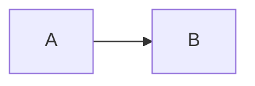

# Conformance fixture

One example of every v1 and Partial row in `docs/markdown-support.md`, in table order. Compare with the same file on github.com.

## Text and structure

### Headings

# H1
## H2
### H3
#### H4
##### H5
###### H6

### Section anchors

[Jump to Lists and tables](#lists-and-tables)

### Custom anchors

<a name="custom-here"></a>Custom anchor target. [Jump to it](#custom-here).

### Emphasis

**bold**, *italic*, ***bold and italic***

### Strikethrough

~~old~~

### Subscript, superscript, underline

H<sub>2</sub>O, x<sup>2</sup>, <ins>underlined</ins>

### Block quotes

> quoted
>
> > nested

### Alerts

> [!NOTE]
> Useful information.

> [!TIP]
> Helpful advice.

> [!IMPORTANT]
> Key information.

> [!WARNING]
> Urgent information.

> [!CAUTION]
> Risks of an action.

### Line breaks

two trailing spaces  
backslash\
html<br/>tag

### Paragraphs

First paragraph.

Second paragraph.

### Backslash escapes

\*not italic\*

### Hidden comments

Before the comment.<!-- this must not show --> After the comment.

### Collapsed sections

<details><summary>More</summary>Hidden text</details>

### Emoji shortcodes

:rocket: :tada: :+1: and literal :not-a-real-emoji:

### Footnotes

Text with a footnote.[^1]

[^1]: The footnote.

## Lists and tables

- unordered
* also unordered
+ also unordered

1. ordered
2. ordered

- nested
  - deeper
    - deepest

- [x] done
- [ ] todo

| Left | Centre | Right |
|:--|:-:|--:|
| a | b | c |

## Code

Inline `code`.

```
fenced, no language
```

```swift
let greeting = "Hello" // highlighted
```

## Links and images

[Inline link](https://example.com) and an autolink: https://example.com

[Relative link](docs/guide.md)


<picture>
  <source media="(prefers-color-scheme: dark)" srcset="images/docs/img/logo-dark.png">
  
</picture>

## GitHub-only references

Thanks @octocat and @github/docs, see #123, fixed in 3f2a1b9c4d5e6f708192a3b4c5d6e7f809123456.

[Permanent code link](https://github.com/github/docs/blob/main/README.md#L1-L5)

## Diagrams


