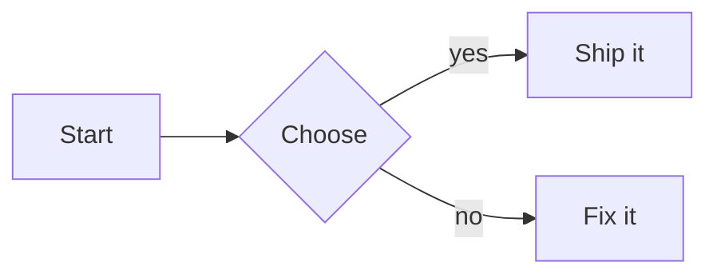
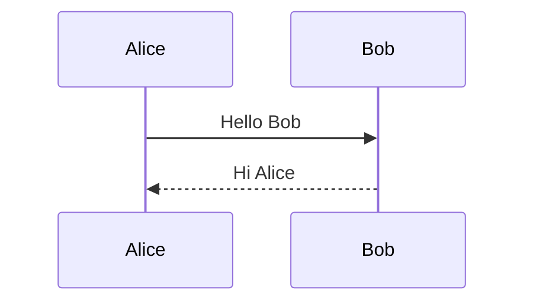

# Diagrams

First, a valid flowchart:



Then an invalid one, broken on purpose. **Expected:** a red "Unable to render diagram" message, with the source shown below it, and the diagrams before and after still drawn:

```mermaid
flowchart LR
  A --> -->
  this is not mermaid
```

Text between the second and third diagram still renders.



Text after all diagrams.
